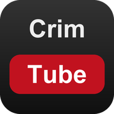

# CrimTube

YouTube-клиент для старых Android и Windows 10 Mobile. Работает через
публичные инстансы Invidious/Piped/yt2009, умеет скачивать видео и аудио,
помнит историю и продолжает просмотр с места остановки.



## Две версии

| Платформа | Файл | Версия |
| --- | --- | --- |
| Android (API 3+) | `CrimTube-0.3.1.apk` | 0.3.1, versionCode 31 |
| Windows 10 Mobile (ARM) | `CrimTube.UWP_0.4.7.0_ARM.appx` | 0.4.7.0 |

Обе версии лежат в разделе [Releases](../../releases). Там же:
`CrimTube.UWP-dependencies-ARM.zip` (framework-пакеты для W10M),
`CrimTube.UWP.cer` (сертификат подписи) и `SHA256SUMS.txt`.

## Возможности

- Популярное, поиск, каналы, подписки, «Смотреть позже», история.
- Встроенный плеер, выбор качества, продолжение просмотра.
- Скачивание видео/аудио: фоновая очередь, уведомление, отмена,
  сортировка и очистка битых файлов.
- Экран «Инстансы»: задержка, ошибки, пинг всех адресов.
- Поиск по каналу.
- Автообновление через `latest.json` (GitHub raw/Pages).

## Установка Android

1. Скачайте `CrimTube-0.3.1.apk` из Releases.
2. Разрешите установку из неизвестных источников.
3. Установите APK.

Приложение не в Google Play. Для автообновления: меню → «Обновления» →
URL `latest.json` (см. ниже).

## Установка Windows 10 Mobile

1. Включите режим разработчика на телефоне.
2. Установите `CrimTube.UWP.cer` в хранилище **Доверенные люди**.
3. Поставьте зависимости из `CrimTube.UWP-dependencies-ARM.zip`
   (Microsoft.NET.Native.Framework 1.7, Runtime 1.7, VCLibs 14.0 ARM).
4. Установите `CrimTube.UWP_0.4.7.0_ARM.appx` через Device Portal,
   `WinAppDeployCmd` или файловый менеджер.

Автообновление UWP: Настройки → «Обновления» → `latest.json`.
Приложение скачает APPX и откроет установщик; тихая установка в UWP
невозможна.

## Свой mux-сервер (для 720p/1080p)

Windows 10 Mobile не умеет склеивать отдельные видео- и аудиодорожки,
поэтому высокие качества можно смотреть через сервер, который собирает
готовый MP4:

- инструкция: [`uwp/server/LAPTOP_SETUP.md`](uwp/server/LAPTOP_SETUP.md);
- запуск: `uwp/server/start_mux_server.bat`;
- в приложении: Настройки → «Mux-сервер» → `http://IP:8765`.

## Автообновление

`update/latest.json`:

```json
{
  "android": {"versionCode": 31, "url": ".../CrimTube-0.3.1.apk", "changelog": "..."},
  "uwp": {"version": "0.4.7.0", "url": ".../CrimTube.UWP_0.4.7.0_ARM.appx", "changelog": "..."}
}
```

Положите файл в публичный репозиторий и укажите его raw-URL в настройках
обновлений обоих приложений. Подробнее — [`uwp/GITHUB_UPDATES.md`](uwp/GITHUB_UPDATES.md).

## Сборка

### Android

Нужны JDK 8, Android SDK 25 и build-tools 25.0.0.

```powershell
cd android
gradlew assembleDebug
```

Готовый APK: `android/app/build/outputs/apk/*.apk`. Подписывайте тем же
ключом, что и предыдущие версии, иначе обновление не встанет.

### Windows 10 Mobile

Нужны Visual Studio 2019 Build Tools с workload **Universal Windows
Platform Build Tools** и локальный `CrimTube.UWP_TemporaryKey.pfx`
(в репозиторий не входит).

```powershell
cd uwp
powershell -ExecutionPolicy Bypass -File .\build-uwp.ps1 -Configuration Release -Platform ARM
```

Готовый APPX: `uwp/CrimTube.UWP/AppPackages/...`.

## Структура

```
android/   исходники Android-приложения
uwp/       исходники UWP-приложения и mux-сервер
docs/      иконка и материалы
dist/      готовые файлы релиза (не коммитится)
update/    шаблон latest.json
```

## Лицензия

WTFPL — см. [LICENSE](LICENSE). Библиотека NNJSON распространяется по MIT
(текст — в `android/LICENSE-NNJSON`).
